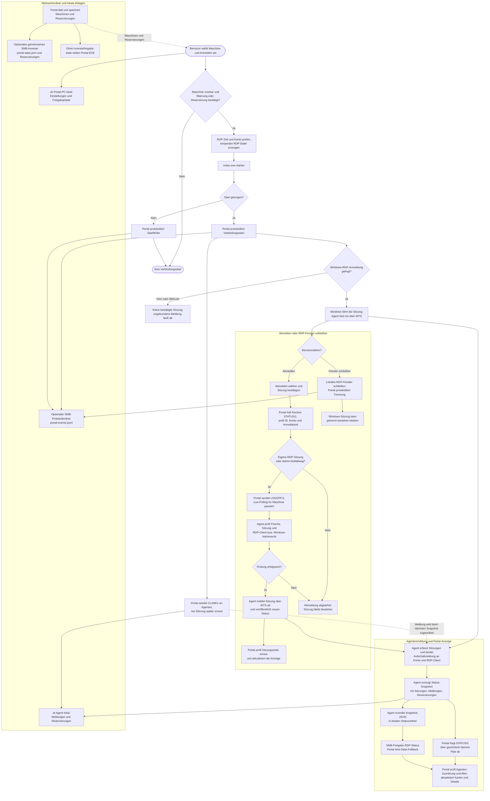

# Anmeldung, Abmeldung und Statusmeldungen

Stand: 07.10.2026. Das Flussdiagramm zeigt den regulären RDP-Weg und die
Meldungen von Portal und Agent. Die optionale administrative Notfall-Abmeldung
ist als eigener Zweig eingezeichnet.

Die Pfeile zu `portal-events.jsonl` zeigen den optionalen gemeinsamen
Protokollordner. Ohne dessen Einrichtung schreibt das Portal das Protokoll bei
seinen Inventardaten. Die Verzweigung zu `state` gilt, wenn kein gemeinsames
Inventar konfiguriert ist. Reservierungen werden im Portal-Inventar gespeichert
und zusätzlich per `RESERVE/1` an den jeweiligen Agenten übertragen; dessen
Snapshot verteilt sie an andere Portale. Die Statusdatei unter `RDP-Status` ist
ein Lese-Fallback, keine Befehlswarteschlange.

Ein erfolgreicher `mstsc.exe`-Start ist nur ein gestarteter Verbindungsversuch.
Das Portal erkennt eine tatsächliche Sitzung erst über Windows und den
Agentenstatus. Das bloße Schließen des RDP-Fensters beendet die Windows-Sitzung
nicht zuverlässig. Für eine echte Abmeldung verlangt der Agent eine aktuelle,
eindeutig identifizierte Sitzung und prüft die Berechtigung selbst. Bleibt die
Antwort auf `LOGOFF/1` aus, fragt das Portal den Status erneut ab, bevor es das
Ergebnis meldet.
