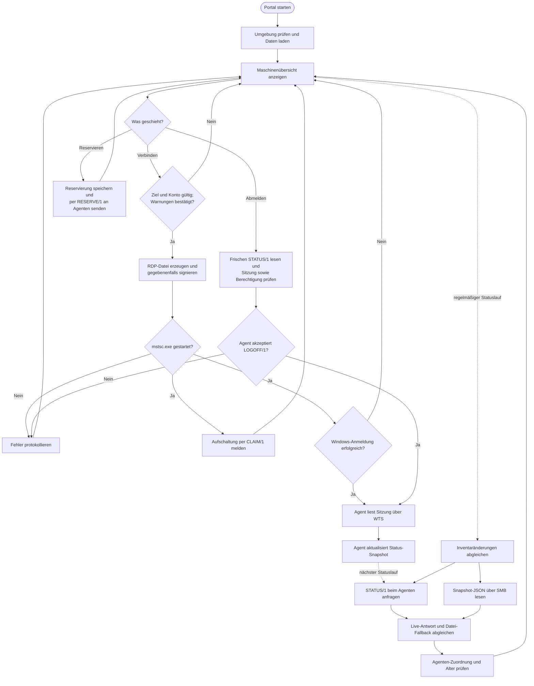
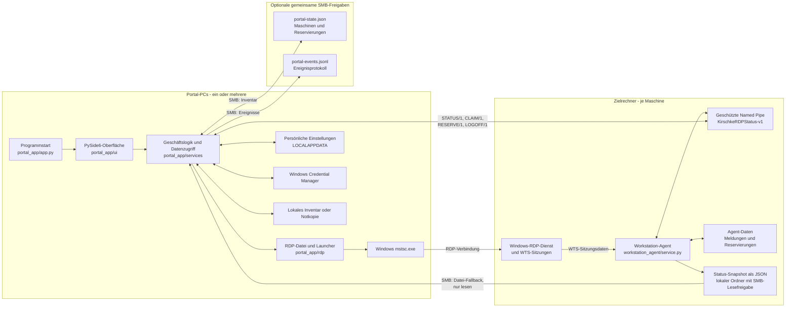

# Programmfluss und Topologie

Stand: 12.10.2026. Die Diagramme zeigen den Ablauf und die Verteilung der
Komponenten im aktuellen lokalen Pilotbetrieb. Ein gestartetes RDP-Fenster ist
noch keine bestätigte Windows-Sitzung.

## 1. Flussdiagramm

Der Status-Timer läuft auch ohne Benutzeraktion. `CLAIM/1` meldet nur den
Verbindungsversuch; erst die vom Agenten gelesene WTS-Sitzung bestätigt eine
Windows-Anmeldung. Das Portal liest beim Statuslauf auch den konfigurierten
Datei-Fallback; eine passende frische Live-Antwort hat Vorrang. Ohne verwertbaren
Snapshot bleibt der Status unbestätigt beziehungsweise wird als veraltet
angezeigt.

## 2. Topologischer Aufbau

`shared/` enthält die Datenmodelle, Validierung und das Pipe-Protokoll, die
Portal und Agent gemeinsam verwenden; es ist kein eigener Netzwerkdienst.
Die gemeinsame Inventarfreigabe ist optional. Ohne sie liegt das Inventar beim
jeweiligen Portal, während Reservierungen zusätzlich über den Agenten zwischen
Portalen sichtbar werden. Auch das gemeinsame Ereignisprotokoll ist optional.
Die Statusfreigabe am Zielrechner ist für das Portal nur lesbar; Aufschaltmeldungen,
Reservierungen und Abmeldeanfragen laufen über die Named Pipe.

## 3. Wer meldet wann an wen?

| Anlass | Richtung und Weg | Inhalt oder Wirkung |
|---|---|---|
| Agentenstart und regelmäßiger Agentenlauf | Agent schreibt JSON in seinen **lokalen** Statusordner; Portale lesen ihn über die SMB-Freigabe. | Maschinen-ID, Zeitstempel, WTS-Sitzungen, Aufschaltmeldungen, Reservierungen und Sitzungsverlauf. Das Agentenintervall beträgt im Setup standardmäßig 30 Sekunden. |
| Portalstart und regelmäßiger Portal-Statuslauf | Jedes Portal fragt **jeden zugeordneten Agenten** mit `STATUS/1` über dessen Named Pipe ab und liest den Datei-Fallback. | Der Agent liest für die Live-Antwort WTS frisch aus und antwortet nur dem anfragenden Portal. Das Portalintervall beträgt standardmäßig 5 Sekunden. |
| Erfolgreicher Start von `mstsc.exe` durch ein Portal | Portal sendet `CLAIM/1` an den Agenten der Zielmaschine. | Agent speichert eine Aufschaltmeldung und bestätigt die Annahme. Die Meldung allein bestätigt keine Windows-Anmeldung. |
| Reservierung geändert | Portal sendet `RESERVE/1` an den betroffenen Agenten. | Agent speichert die Reservierungen dieser Maschine und bestätigt die Annahme. Andere Portale erhalten sie bei ihrer nächsten Statusabfrage. |
| Abmeldung angefordert | Portal sendet nach frischer Statusprüfung `LOGOFF/1` an den Agenten. | Agent prüft Sitzung und Berechtigung, meldet sie gegebenenfalls über WTS ab und antwortet dem anfragenden Portal. Nach erfolgreicher Abmeldung schreibt er die Statusdatei sofort neu. |

Der Agent verteilt keine Push-Nachrichten an andere Portale oder Agenten.
Agentenereignisse werden lokal erkannt; sie werden im Pilotbetrieb nicht als
eigener Ereignisstrom an das Portal übertragen. Das gemeinsame
`portal-events.jsonl` wird vom **Portal** geschrieben.

Für die einzelnen Nachrichten und Sicherheitsprüfungen siehe
[Anmeldung, Abmeldung und Statusmeldungen](anmeldung-abmeldung-und-statusmeldungen.md).
Die konkreten Speicherorte und Ausfallszenarien stehen unter
[Datenspeicherung](datenspeicherung.md).
