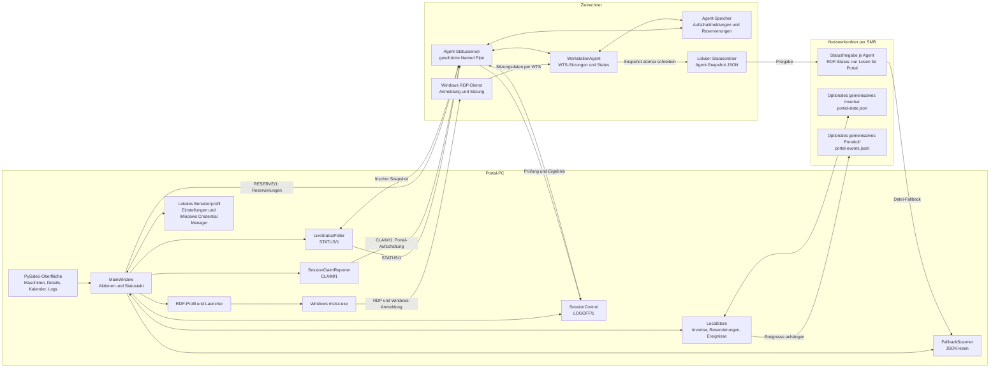

# Programmaufbau und Signalkette

Stand: 07.10.2026. Schematische Darstellung des aktuellen Pilotbetriebs.
Die Pfeile zeigen die Richtung der Daten oder Anfragen; die Rückantwort läuft
über denselben Kanal zurück. Eine gestartete RDP-Verbindung und eine bestätigte
Windows-Anmeldung sind unterschiedliche Zustände.

**Einordnung der Ablagen:** Ohne gemeinsames Inventar verwendet `LocalStore`
`state/portal-state.json` neben der Portal-EXE. Persönliche Einstellungen und
die Pfade der Freigaben liegen unter `%LOCALAPPDATA%\KirschkeRDPPortal\`;
Anmeldedaten für Freigaben liegen im Windows Credential Manager. Ein
eigenständiger Protokollordner ist optional; sonst liegt das Ereignisprotokoll
bei den Inventardaten. Die Statusfreigabe des Agenten ist für das Portal nur
lesbar. Das Portal schreibt seine Aufschaltmeldungen und Reservierungen über die
Named Pipe an den Agenten, nicht in die Statusfreigabe.

**Signalkette:** Der Agent liest die tatsächlichen Sitzungen über die Windows
Terminal Services API (WTS). Er liefert einen frischen Snapshot über
`STATUS/1` und schreibt zusätzlich eine JSON-Datei für den SMB-Fallback. Das
Portal ordnet die Meldung anhand der Agenten-ID beziehungsweise der eindeutigen
Maschinenzuordnung zu und aktualisiert die Oberfläche. Ein `CLAIM/1` meldet,
wer eine Verbindung über das Portal gestartet hat; diese Meldung allein beweist
weder eine erfolgreiche Anmeldung noch eine Abmeldeberechtigung.

Details zu den Dateien und Ausfällen: [Datenspeicherung](datenspeicherung.md).
